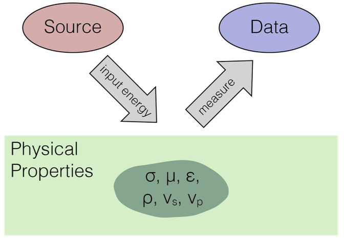

This presentation was given as a part of the Geophysics Day at the [Student-Industry Mineral Exploration Workshop (S-IMEW)](https://pdac.ca/student-early-career/s-imew/s-imew-alumni/s-imew-2024) hosted by PDAC in Sudbury, Ontario on May 6, 2024.

Geophysical data—whether maps, profiles, or time series—capture complex signatures of the subsurface that are not always directly interpretable. Inversion provides a framework for translating these data into models of the Earth’s physical properties, helping us connect geophysical observations to geologic structure and processes. This talk introduces the fundamental ideas and terminology of geophysical inversion, including the relationship between forward modeling, data fitting, and regularization. Using illustrative examples, we explore why inversion is needed, what makes it challenging, and how visualization helps in interpreting results. The presentation concludes by highlighting open-source resources such as SimPEG
 and GeoSci.xyz
 that make these concepts accessible for learning, teaching, and research.

